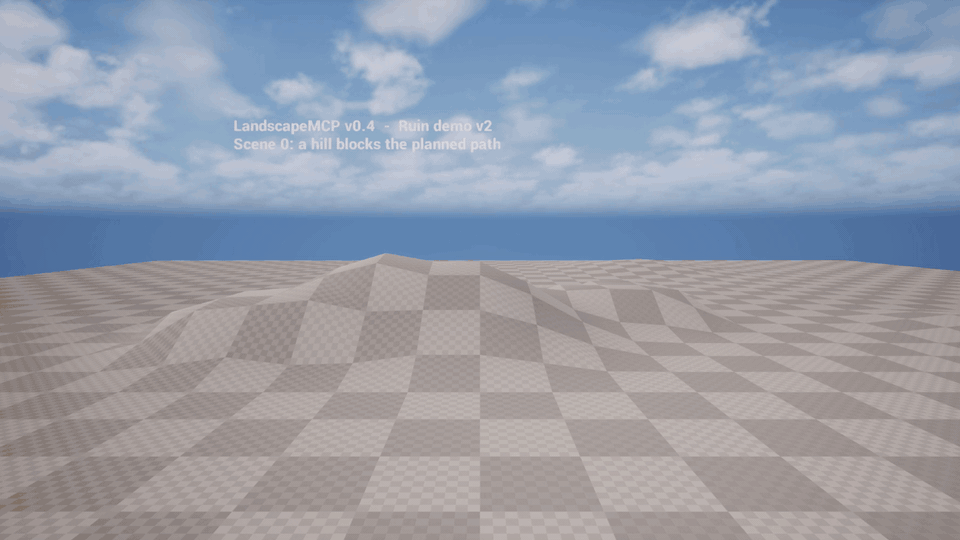

# LandscapeMCP

Unreal EngineのLandscapeを、AI Agent / MCPクライアントから安全に解析・編集するためのEditor Toolsetです。

Unreal Engine 5.8の公式Model Context Protocol（`ToolsetRegistry` → `ModelContextProtocol`）へ、追加Toolsetとして登録されるEditor Pluginです。独立したMCP Serverは含みません。

- Toolset名: `LandscapeMCP.LandscapeMCPToolset`
- Toolset Version: `0.5`（15 Tool）
- 現在のリリース: v0.5.0（実験的。Plugin descriptorでも`IsExperimentalVersion`を指定しています）
- 配布形態: ソースのみ。Build済みのBinariesは配布していません

## デモ（v0.4）

[](docs/media/landscapemcp_v04_ruin_demo.mp4)

地形を解析し、変更をDry-runで安全に確認してから歩ける道をApplyし、その上にモジュール式の遺跡を組み立てるまでを、MCPから操作したUnreal Editorで記録したものです（約49秒）。字幕の数値はToolの実際の戻り値です。高画質版: [MP4（1920×1080）](docs/media/landscapemcp_v04_ruin_demo.mp4)

| 道の帯（歩行可能角20度） | Before | After |
|---|---|---|
| 歩行可能な三角形 | 95 / 170（55.9%） | 170 / 170（100%） |
| 最大傾斜 | 43.5度 | 19.4度 |

- **解析**: `GetHeightRegion`、`AnalyzeSlopeNeighborhood`、`EvaluateWalkabilityRegion`
- **`CreateWalkablePath`**: Dry-runで`PREVIEW_READY`（244頂点）→ Applyで`APPLIED`（244 / 244頂点）。実測が計画と一致し、rollbackは`NOT_NEEDED`。1回のApplyは1つのTransactionで、Undoで戻せます
- **`FlattenRectangle`**: 階段の足元を同じくDry-run → Applyで整地
- **安全性**: 対象は完全Object Pathで指定した1つのLandscapeだけ。条件を満たさない計画は書き込まずに拒否します（fail-closed）

遺跡のmoduleの配置は、UE公式のEditor Toolsetで行っています。本Pluginの機能ではなく、遺跡のAssetも本リポジトリには含みません。

## 概要

AI AgentがLandscapeを扱うときに必要な「作る → 編集する → 測る → 歩行可能性を評価する」の一連を、範囲と対象を限定したToolとして提供します。

v0.3までは円形ブラシによる局所的な編集と地形の解析が中心でした。v0.4では、矩形の整地、経路に沿った平坦化、勾配を抑えた歩ける道の作成という、ゲームの地形づくりで実際に使う単位の編集Toolを追加しています。

v0.5では、Foliageが付いたLandscapeを扱えるようにしました（[Foliage Safety](#foliage-safetyv05)）。Foliageを動かす・消す・置き直す機能はありません。Foliageへの影響をDry-runで予測し、影響がある場合や判断できない場合はApplyを拒否します。

対象は明示された1つのLandscapeだけです。名前やラベルからの推測、対象がない場合の自動作成、保存は行いません。対応していない構成のLandscapeは、編集を拒否します（多くの構成は読み取りも拒否します）。対応範囲は[Limitations](#limitations)を先に確認してください。

## 主な機能

- **作成**: 読み込み済みのLevelへ、小規模で平坦なLandscapeを作成
- **円形ブラシの編集**: 盛り上げ・掘り下げ、平滑化、指定高度への平坦化
- **地形authoring（v0.4）**: 矩形の平坦化、Polylineに沿った帯状の平坦化、最大勾配を指定した歩ける道の作成
- **高さの取得**: 1点、または矩形領域をまとめて取得
- **傾斜の解析**: 指定位置の代表的な傾斜と向き、周囲の実三角形から求めた局所的な最大・平均傾斜
- **歩行可能性の評価**: 呼び出し側が渡した歩行可能角に対する、1点または領域のgeometry評価
- **Foliage Safety（v0.5）**: 地形authoringの3 ToolがFoliageへの影響（浮く・埋まる・傾斜の変化・Engineによる移動）を予測し、影響がない場合だけ書き込む。Foliageの詳細調査（`InspectFoliage`）と、対応機能の一覧（`GetCapabilities`）

書き込みToolはすべて、Dry-run（既定）で結果を確認してから本実行する形です。本実行はEditorのUndo／Redoで戻せます。保存はしません。

## Tool一覧

### 地形authoring（v0.4で追加）

| Tool | 種別 | 概要 |
|---|---|---|
| `FlattenRectangle` | 書き込み | 軸平行の矩形を指定World高度へ平坦化。矩形の外側は`falloffCm`の距離でなだらかに元の地形へつなぐ |
| `FlattenPath` | 書き込み | Polylineに沿った帯状の領域を平坦化。高さは固定値、始点の高さ、経路に沿った元の高さの3方式 |
| `CreateWalkablePath` | 書き込み | 端点の高さを保ったまま、指定した最大勾配以下になる縦断形状を計画して帯状に整地。経路探索はしない |

<!-- TODO(media): FlattenPath GIF -->
<!-- TODO(media): FlattenRectangle GIF -->

3 Toolは共通の結果（Terrain Operation Result）を返します。変更前・計画後・実測後の高さと傾斜の統計、変更頂点数、範囲、経路の縦断profile、警告、rollbackの状態を含みます。

入力と結果の定義は[v0.4 Tool仕様](docs/v0.4-tools.md)、本実行の検証手順と失敗時の挙動は[v0.4 Apply contract](docs/v0.4-apply.md)にあります。

### Foliage SafetyとCapability（v0.5で追加）

| Tool | 種別 | 概要 |
|---|---|---|
| `GetCapabilities` | 読み取り | Engine・Adapter・Toolset・Pluginの版と、機能ごとの対応状況（Foliageの扱い、World Partition、現在のsnap modeなど）を返す。対象のLandscapeは不要 |
| `InspectFoliage` | 読み取り | 矩形内のFoliage instanceを、種類ごとの集計と一覧（上限4096件、既定256件）で返す。各instanceの付属先、足元の地形高度、地形からの高さ、局所傾斜と、判定できない形式・状態（`unknowns`）を含む |

どちらもLandscape・Foliage・Package・Undo履歴を変更しません。入力と出力の定義は[v0.5 実装契約](docs/v0.5-contract.md)の§4にあります。

### 作成・円形ブラシ・解析

| Tool | 種別 | 概要 |
|---|---|---|
| `CreateLandscape` | 書き込み | 指定した読み込み済みLevelへ平坦なLandscapeを作成 |
| `GetHeight` | 読み取り | 指定World XYの高度を取得（元Heightfieldのbilinear補間） |
| `SculptRegion` | 書き込み | 円形範囲を盛り上げる／掘り下げる |
| `SmoothRegion` | 書き込み | 円形範囲へ3x3近傍平均を1回適用 |
| `FlattenRegion` | 書き込み | 円形範囲を指定World高度へ近づける |
| `GetSlope` | 読み取り | 指定World XYの傾斜角・最大上昇方向・法線を取得 |
| `GetHeightRegion` | 読み取り | 矩形領域の高度を格子で取得し、最小・最大・平均と最大傾斜を集計 |
| `EvaluateWalkability` | 読み取り | 指定位置の傾斜を、渡された歩行可能角と比較 |
| `AnalyzeSlopeNeighborhood` | 読み取り | 中心傾斜と、周囲の実三角形から求めた局所最大・平均傾斜 |
| `EvaluateWalkabilityRegion` | 読み取り | 矩形領域の実三角形を、渡された歩行可能角に対して一括評価 |

入力・出力・単位・計算式は[Tool仕様](docs/tools.md)にあります。距離・高さ・座標はワールドcm、角度は度です。この10 Toolの入出力の構造はv0.3.0から変えていません。

### 中心傾斜と局所最大傾斜

傾斜には2種類の値があり、用途が違います。

| 値 | 求め方 | 向いている用途 | 弱点 |
|---|---|---|---|
| 中心傾斜（`GetSlope`の`slopeDegrees`、`centerSlopeDegrees`） | 中心から`sampleDistanceCm`離れた4点の中心差分 | その場所の代表的な傾きと向き | 対称な地形で打ち消し合う。丘の頂点・尾根・谷底・鞍部は周囲が急でも0度になる |
| 局所最大傾斜（`localMaxSlopeDegrees`、`maxTriangleSlopeDegrees`、`EvaluateWalkabilityRegion`の`maxSlopeDegrees`） | Landscapeの実三角形ごとの傾斜の最大値 | 「この周辺に急な面があるか」の検出 | 1枚でも急な三角形があれば大きくなる。向きは最大の三角形のものだけ |

歩けるかどうかを見るときは、中心傾斜だけで判断せず、`AnalyzeSlopeNeighborhood`か`EvaluateWalkabilityRegion`で周囲の実三角形も確認してください。

## Dry-runとApply（v0.4の3 Tool）

| `bDryRun` | 動作 |
|---|---|
| `true`（既定） | 入力の検証、地形の読み取り、変更計画だけを行う。Landscapeへ書き込まず、Transaction・Package dirty・保存もない。成功は`PREVIEW_READY`または`NO_CHANGE` |
| `false` | 検証を通った場合だけLandscapeの高さを変更する。成功は`APPLIED`（変更あり）または`NO_CHANGE`（すでに計画どおり） |

<!-- TODO(media): DryRun previewの結果例（screenshot） -->

**Dry-runの成功は、Applyが受理されることを保証しません。** Applyは、Dry-runでは見ない条件を追加で検査します（Editorのtransactionが空いていること、Autosave・自動checkout・source controlが無効であること、materialとGrassの状態、collisionの状態、書き込み直前に地形が変わっていないこと）。条件を満たさない場合は書き込まずに拒否します。

Applyの流れは次のとおりです。

1. **検証と計画**: 対象と入力を検証し、量子化後の高さまで含めた変更計画を作る。
2. **書き込み前のcollision確認**: 現在のLandscape collisionが、元データから独立に予測した形と一致することを確認する。`CreateWalkablePath`では、計画後に予測されるcollisionでも勾配の条件を満たすことを確認する。
3. **直前の再検証**: 対象・地形・周辺の状態が計画時から変わっていないことを確認する。変わっていれば`STALE_PLAN`で拒否し、自動では再計画しない。
4. **書き込み**: 自分専用のTransactionを1つだけ作って書き込む。
5. **書き込み後の検証**: 元データ、geometry、周辺の状態、実際のcollisionを読み直して、計画と一致することを確認する。
6. **失敗時のrollback**: 5で一致しなければ、自分のTransactionだけをUndoし、元の地形とcollisionに戻ったことを検証する（`ROLLED_BACK`）。

<!-- TODO(media): Undo / Redo GIF -->

rollback後に元へ戻ったことを証明できなかった場合は`ROLLBACK_FAILED`を返し、以後この3 ToolのApplyを止めます（safety latch）。Dry-runと他の10 Toolは使えます。解除はEditorの再起動だけで、MCPから解除するToolはありません。再起動の前に、地形の状態を確認してください。

失敗時は公式MCPの`isError`とともに、`errorCode`・`stage`（どの段階で拒否したか）・`reason`・`rollbackStatus`を含む診断を返します。

### collisionの検証とprop

Applyは、変更に関わるすべての三角形について、予測したcollisionと実際のcollisionをline traceで比較します。UEのLandscape collision（Chaos）は元の高さを別の16-bit値へ量子化し直すため、「元データと同じ形」ではなく「元データから計算した量子化後の形」と比較しています。

Landscapeの上下にStaticMeshなどのprop（WorldStaticのcollision）があっても、検証は続けられます。propは読み飛ばし、対象Landscapeのcollisionに到達したhitだけを検証します。

- propは動かしません。地形を変更してもpropは追従しないので、浮いたり埋まったりします。
- 検証するのは対象Landscapeのcollisionだけです。propの形や、propとの干渉は見ません。
- 読み飛ばせるのは1回の検証で256 componentまでです。それより多い場合は拒否します。
- Foliage instanceはprop扱いではなく、v0.5の[Foliage Safety](#foliage-safetyv05)で評価します。

## Foliage Safety（v0.5）

v0.5は、Foliageを壊さないことを優先しています。Foliageを書き換えるApplyはありません。

**v0.4の3 Tool（`FlattenRectangle`、`FlattenPath`、`CreateWalkablePath`）**

結果に`foliage`を追加しました（既存のfieldは変更なし）。読み取り範囲内の各instanceについて、計画どおりに書き込んだ場合を予測します。

| 分類 | 意味 |
|---|---|
| `UNCHANGED` | 足元の高さと傾斜が変わらない |
| `FLOATING` / `BURIED` | 地形が下がって浮く／上がって埋まる（予測量cm） |
| `SLOPE_CHANGED` | 高さは変わらないが、足元の三角形の傾斜が変わる |
| `MAY_BE_MOVED_BY_ENGINE` / `MAY_BE_DELETED_BY_ENGINE` | Project設定のsnap modeにより、UEがTransactionの外でinstanceを動かす・消す可能性がある |
| `UNKNOWN` | 判定できない（下の非対応の形式・状態、読めない地形） |

足元の高さは、Landscapeが実際に描画・衝突判定する三角形（対角線00-11）から求めます。`GetHeight`などの読み取りToolが返すbilinear補間の高さとは別の定義です。閾値は固定で、高さは量子化の半段、傾斜は0.01度を超えたら変化ありです。

全体の判定（`foliage.verdict`）が`NO_FOLIAGE`か`SAFE_TO_APPLY`のときだけ、Applyは書き込みます。それ以外は`FOLIAGE_SAFETY_CONFLICT`で拒否し、何も書き込みません。Applyは書き込み直前にFoliageを取り直して、instance・snap mode・判定不能な状態が変わっていないことを確かめます（変わっていれば`stage`は`preWrite`）。書き込み後は、遅延していたLandscapeの更新を流してから、全LevelのFoliage Actorが1 byteも変わっていないことと、足元の地形が予測どおりであることを検証します。一致しなければ自分のTransactionだけをUndoし、Foliageを含めて元に戻ったことを確かめます（v0.4と同じrollbackとsafety latch）。

**拒否する条件（Apply）**

- 範囲内のinstanceが1つでも`UNCHANGED`以外
- Project設定`FoliageLandscapeSnappingMode`が`DontSnap`以外で、対象Landscapeに付属したinstanceがある（範囲の外を含む）。設定は変更しません
- 判定できない形式・状態: Landscape Grass、Procedural Foliage、Actor Foliage、対象と別のLevelにあるFoliage（非表示・ロック中のLevelを含む）、読み込まれていないstreaming level、走査の上限（65,536 instance）の超過、付属先を証明できないinstance

**円形ブラシの3 Tool（`SculptRegion`、`SmoothRegion`、`FlattenRegion`）**

v0.4と同じく、対象Landscapeに付属したFoliageがあれば、Dry-runもApplyも拒否します。v0.5では、非表示・ロック中のLevelにあるFoliageと、付属先を証明できないinstanceも付属として扱います。読み込まれていないstreaming levelがあるWorldでは、書き込みを拒否します。Landscape Grassがある、またはmaterialの中を確かめられないLandscapeへのApplyも拒否します（下の[Limitations](#limitations)の「Landscape Grass」）。

**読み取りTool**

v0.4ではFoliageが付いたLandscapeを読み取りも拒否していましたが、v0.5では`GetHeight`などの6 Tool、`InspectFoliage`、`GetCapabilities`、3 ToolのDry-runが使えます。読み取りはLandscapeもFoliageも変更しません。

**既知の制限**

- **円形ブラシは付属していないFoliageを保護しない**: 円形ブラシの3 Toolは付属の有無だけを見て、書き込み後のFoliageの検証をしません。対象Landscapeに付属していない（`BaseId`が無効な）instanceが範囲内にあると、地形の変更で浮いたり埋まったりします。v0.4からの制限です。Foliageがある場所の編集には、v0.4の3 Toolを使ってください
- **全instanceの走査**: 付属の判定は、評価のたびに全LevelのFoliageの全instanceを1回ずつ走査します（上限なし）。数十万instance以上のWorldでは、1回の評価に数msから数十msかかる場合があります。範囲内の分類は、読み取り範囲に重なる65,536 instanceまでです
- **Foliageを動かすApplyはない**: 影響がある編集は拒否するだけです。Foliageを先に動かすか、別の場所を編集してください

### 同じrequestの再送（retry）

timeoutなどで同じrequestが2回届いても地形を二重に変更しないよう、Applyに成功したrequestを記録しています。

- 引数が完全に同じrequestが届き、**現在の地形が記録した結果と一致している**場合は、書き込まずに`NO_CHANGE`を返します。
- 地形が変わっている場合（Undoした、別の編集が重なった）は、記録を使わず、新しいrequestとして検証と計画をやり直します。`Apply A → Undo → Apply A`は2回目も普通に適用されます。
- 記録は128件までで、古いものから消えます。記録はEditorの再起動で消えます。

**同じrequestが永久に冪等なわけではありません。** 記録が消えた後（128件より古い、またはEditor再起動後）に同じrequestを送ると、新しい編集として実行されます。falloffの部分は元の高さとのblendなので、もう一度blendされて結果が変わります。

## Requirements

Tested:

- Unreal Engine 5.8 / Windows 64-bit（Win64 Editor）

必要なもの:

- Unreal Engine 5.8のEditor。本PluginはEditor専用で、Runtime／Cooked向けのModuleやContentは含みません
- Unreal Engine側のModel Context Protocol環境。公式Pluginの`ToolsetRegistry`（本Pluginのdescriptorが依存を宣言）と`ModelContextProtocol`（MCPとして公開するために必要）
- UE5.8に対応したWin64のC++ Build環境。本Pluginはソースで配布しており、利用する側でのBuildが必要です

他のEngineバージョン、OS、Targetは検証していません。動作は保証しません。collisionの検証はUE5.8のChaos heightfieldの実装に合わせているため、別のEngineバージョンではApplyが拒否される可能性があります。

Build Moduleの依存はCore、CoreUObject、Engine、ToolsetRegistry、Landscape、UnrealEd、Foliage、RenderCore、Json、JsonUtilities、SourceControl、Chaos、PhysicsCoreで、すべてEngine付属です。第三者ライブラリは含みません。

## Installation

本Pluginはソースで配布しています。このリポジトリにも、GitHub ReleaseにもBuild済みのBinariesは含まれません。利用するには、手元のUnreal Engine 5.8でBuildします。

最終的な配置は次のとおりです。

```
<Project>/Plugins/LandscapeMCP/
├── LandscapeMCP.uplugin
├── Source/
└── Binaries/        （Buildで生成される）
```

### ソースからBuildする

1. このリポジトリをcloneまたはdownloadします。
2. `RunUAT BuildPlugin`でBuildします。出力先には、リポジトリの外の新しいフォルダを指定します。

   ```powershell
   & '<UE_ROOT>/Engine/Build/BatchFiles/RunUAT.bat' BuildPlugin `
     '-Plugin=<REPO_ROOT>/LandscapeMCP.uplugin' `
     '-Package=<NEW_PACKAGE_DIR>' -TargetPlatforms=Win64 -NoP4
   ```

3. Unreal Editorを終了し、出力フォルダの中身（`Intermediate`を除く）を`<Project>/Plugins/LandscapeMCP/`へ置きます。
4. Unreal Engine 5.8でProjectを開き、下の「Pluginの有効化と検出の確認」の手順でPluginを有効にします。

`<Project>/Plugins/LandscapeMCP/`へソースを置き、Projectを対象にUnrealBuildToolでPluginをBuildする方法も使えます。

BuildしたBinariesは、Buildに使ったEngineでだけ読み込めます。Engineを更新した場合はBuildし直してください。

**Windowsのパス長の注意**: Windowsでは、ディレクトリのパスが長いとUnrealBuildToolや`RunUAT BuildPlugin`が失敗する場合があります（中間ファイルのパスが260文字の制限を超えるため）。Pluginの展開先、Projectの配置先、`-Package`の出力先には、`D:/Build/LMCP`のような短いパスを使ってください。長いパスで失敗した場合は、まず短いパスで再試行してください。

### Pluginの有効化と検出の確認

1. `<Project>/Plugins/LandscapeMCP/`にPluginが置かれていることを確認し、Unreal Engine 5.8でProjectを開きます。
2. Edit → Pluginsを開き、`Landscape MCP`を検索して有効にします。配置しただけでは有効になりません。`RunUAT BuildPlugin`の出力では、descriptorの`EnabledByDefault`が保持されないためです。ソースを直接置いた場合も、ここで有効になっていることを確認してください。
3. 同じ画面で、公式Pluginの`ModelContextProtocol`を有効にします。`ToolsetRegistry`は本Pluginの依存なので、有効化を求められたら承諾します。
4. Editorから再起動を求められたら、再起動します。
5. Model Context Protocol側で、All ToolsetsまたはLandscapeMCPのToolsetを有効にします。
6. MCPクライアントをEditorのMCP Serverへ接続します。接続先はModel Context Protocol Pluginの設定に従ってください。検証環境では`http://127.0.0.1:8000/mcp`（HTTP）でした。
7. `list_toolsets`に`LandscapeMCP.LandscapeMCPToolset`が現れ、`describe_toolset`でVersion `0.5`と15 Toolが返ることを確認します。`GetCapabilities`の`pluginVersionName`が`0.5.0`であることでも、Buildした版を確認できます。

Pluginsの画面を使わない場合は、`.uproject`の`Plugins`へ`{"Name": "LandscapeMCP", "Enabled": true}`と`{"Name": "ModelContextProtocol", "Enabled": true}`を追加しても同じです。

PCG、Modeling、Scriptable Toolsなど、他のPluginは本Pluginの依存ではありません。

## MCPからの利用方法

公式MCP Serverが公開するのは`list_toolsets`、`describe_toolset`、`call_tool`の3つです。本PluginのToolは、`call_tool`に`toolset_name`と`tool_name`を指定して呼び出します。

```json
{
  "name": "call_tool",
  "arguments": {
    "toolset_name": "LandscapeMCP.LandscapeMCPToolset",
    "tool_name": "GetHeight",
    "arguments": {
      "landscapePath": "/Temp/Untitled_1.Untitled:PersistentLevel.AI_LandscapeTest",
      "worldX": 3150,
      "worldY": 3150
    }
  }
}
```

以下の例では、`arguments`の中身だけを示します。パスは例なので、実際の値へ置き換えてください。

### 例: 作る → 編集する → 測る → 歩行可能性を評価する → 道を通す

前提として、World Partitionを使わないLevelをEditorで開き、そのULevelの完全Object Pathを用意します。

**1. 作る（`CreateLandscape`）**

まずDry-runで検証します。

```json
{"levelPath":"/Temp/Untitled_1.Untitled:PersistentLevel","landscapeName":"AI_LandscapeTest","location":{"x":0,"y":0,"z":0},"scale":{"x":100,"y":100,"z":100},"componentCountX":1,"componentCountY":1,"sectionsPerComponent":1,"quadsPerSection":63,"initialWorldHeight":0,"bDryRun":true}
```

成功したら、同じ入力を`"bDryRun":false`にして実行します。64×64 Sample、63m四方の平坦なLandscapeができます。返された`landscapePath`を以降のToolへ渡します。

**2. 編集する（`SculptRegion`）**

丘を作ります。これもDry-runで変更量を確認してから、`"bDryRun":false`で実行します。

```json
{"landscapePath":"/Temp/Untitled_1.Untitled:PersistentLevel.AI_LandscapeTest","center":{"x":3000,"y":3000},"radiusCm":600,"strengthCm":600,"falloff":1,"bRaise":true,"bDryRun":true}
```

**3. 測る（`GetSlope`、`AnalyzeSlopeNeighborhood`）**

丘の斜面の傾斜と向きを取得します。

```json
{"landscapePath":"/Temp/Untitled_1.Untitled:PersistentLevel.AI_LandscapeTest","worldX":3300,"worldY":3000,"sampleDistanceCm":100}
```

丘の頂点では`GetSlope`が0度になります（両側の斜面が打ち消し合うため）。周囲の急な面は`AnalyzeSlopeNeighborhood`で確認します。

```json
{"landscapePath":"/Temp/Untitled_1.Untitled:PersistentLevel.AI_LandscapeTest","worldX":3000,"worldY":3000,"radiusCm":300,"sampleDistanceCm":100}
```

この例では`centerSlopeDegrees`が0、`localMaxSlopeDegrees`が約58度になります。

**4. 歩行可能性を評価する（`EvaluateWalkabilityRegion`）**

丘を含む一帯を、歩行可能角44.77度で評価します。`walkableFloorAngleDeg`には、対象CharacterのWalkable Floor Angleを呼び出し側で調べて渡します。

```json
{"landscapePath":"/Temp/Untitled_1.Untitled:PersistentLevel.AI_LandscapeTest","minX":2400,"minY":2400,"maxX":3600,"maxY":3600,"walkableFloorAngleDeg":44.77}
```

この例では`classification`が`MIXED`になり、`walkableCount`／`unwalkableCount`／`worstLocation`から、どこが急すぎるかが分かります。

**5. 道を通す（`CreateWalkablePath`）**

丘を横切る幅4mの道を、最大勾配30度で計画します。`points`は道の中心線、`widthCm`は道の全幅、`falloffCm`は道の外側で元の地形へつなぐ距離、`maxDeltaCm`は1頂点あたりに許す高さの変更量の上限です。

```json
{"landscapePath":"/Temp/Untitled_1.Untitled:PersistentLevel.AI_LandscapeTest","points":[{"x":1500,"y":3000},{"x":4500,"y":3000}],"widthCm":400,"falloffCm":300,"maxSlopeDegrees":30,"maxDeltaCm":300,"bDryRun":true}
```

`status`が`PREVIEW_READY`なら、`path.profileSamples`で縦断形状を、`delta`で変更量を確認し、同じ入力を`"bDryRun":false`にして実行します。`APPLIED`が返れば、道の中心部（core）のすべての三角形が、元データと実際のcollisionの両方で勾配の条件を満たしています。条件を満たす計画が作れない場合は拒否されます（`CANNOT_SATISFY_WALKABILITY`、`MAX_DELTA_EXCEEDED`など）。`maxDeltaCm`を増やすか、経路を変えてください。

`FlattenPath`と`FlattenRectangle`も同じ手順（Dry-run → 確認 → Apply）で使います。

### 呼び出しの原則

- 書き込みToolは、Dry-runで結果を確認してから本実行します。
- エラーが返ったら、それに依存する後続の処理を止めます。別の対象を推測して続行しないでください。
- 編集の取り消しには、Editorの通常のUndoを使います。
- `ROLLBACK_FAILED`が返ったら、編集を止めて地形の状態を確認してください。
- PIE中は15 Toolすべてが使えません。

## Safety design

誤った対象を編集しないこと、気付かないうちに状態を変えないことを優先した設計です。ただし、これは被害の範囲を限定するための仕組みで、結果の正しさを保証するものではありません。

- **完全Object Path**: 対象は読み込み済みActor／Levelの完全Object Pathで指定します。名前やラベルから推測しません。
- **Dry-run**: 書き込みToolの`bDryRun`は既定で`true`です。Dry-runはHeightfield・Package・Undo履歴を変更しません。
- **検証付きのApply（v0.4の3 Tool）**: 書き込みの前後で地形とcollisionを検証し、失敗したら自分のTransactionだけをUndoして、元に戻ったことを確認します。
- **Undo / Redo**: 実編集はTransactionとして記録され、EditorのUndo／Redoで戻せます。v0.4の3 Toolは、1回のApplyにつきTransactionを1つだけ作ります。
- **rollback失敗時の停止**: 元に戻ったことを証明できない場合は、Editorを再起動するまでv0.4の3 ToolのApplyを止めます。
- **保存しない**: 保存・Autosave APIを呼びません。Editorの設定も変更しません。ただし実編集はPackageをdirtyにします。v0.4の3 ToolのApplyは、AutosaveやSource Controlの自動checkoutが有効な場合は拒否します。
- **read-onlyの分析Tool**: `GetHeight`、`GetSlope`、`GetHeightRegion`、`EvaluateWalkability`、`AnalyzeSlopeNeighborhood`、`EvaluateWalkabilityRegion`、`InspectFoliage`、`GetCapabilities`は、Transaction・Modify・Package dirty化を行いません。
- **Foliageを保護する（v0.5）**: Foliageへの影響がある、または判断できない編集は書き込まずに拒否します。Foliageは書き換えません。詳細は[Foliage Safety](#foliage-safetyv05)にあります。
- **PIE / Save / GC中は拒否**: Editorのgame thread上、現在のEditor Worldだけを対象とし、PIE中・Package保存中・GC中は読み取りも拒否します。
- **fail-closed**: 入力や対象が不明・不正な場合、対応していない状態の場合は、実行せずにFAILします。NaN／Infinity、範囲外、逆転した範囲を拒否します。
- **上限**: 作成は262144 Sample、編集は16384 Sample、領域の高さ取得は1024 Sample、実三角形の解析は16384頂点まで。v0.4の3 Toolは経路64点・長さ100m、幅と矩形の辺50m、falloff 25m、高さの変更量10mまで。
- **非対応のLandscapeは拒否**: 下の[Limitations](#limitations)にある構成は、編集だけでなく読み取りも拒否します。

詳細は[安全境界](docs/safety.md)と[v0.4 Apply contract](docs/v0.4-apply.md)にあります。

## Limitations

対応範囲は意図的に狭くしています。当てはまらない場合はFAILします。

**対象のLandscape（全Tool共通）**

- 読み込み済みの単一の`ALandscape`だけ。World Partition、external actorを使うLevel、Landscape Streaming Proxy、Landscapeの派生classは非対応
- 回転していないこと。Scaleは各軸とも正で[1,1000]
- 標準のEdit Layerが1つだけで、表示・ロック解除・height alphaが1。複数または特殊なEdit Layer、Blueprint brushは非対応
- Nanite Landscape、Visibility Holeは非対応
- Foliageの扱いは[Foliage Safety](#foliage-safetyv05)のとおり。Landscape Grass、Procedural Foliage、Actor Foliage、他のLevelのFoliage、読み込まれていないstreaming levelは判定できないものとして扱い、地形authoringのApplyを拒否します

**Landscape Grass（v0.5.0では非対応）**

- Landscape Grass Output（またはGrass Type）を使うLandscapeへの編集は、v0.5.0では非対応です。
- v0.4の3 ToolのApplyは、Grassの状態があるLandscapeを`UNSUPPORTED_GRASS_STATE`で拒否します。Dry-runの`foliage`ではGrassを判定できないもの（`LANDSCAPE_GRASS`）として扱い、`UNKNOWN`になります。
- 円形ブラシの3 Tool（`SculptRegion`、`SmoothRegion`、`FlattenRegion`）のApplyも、Grassの状態があるLandscapeを拒否します。`message`の先頭は`UNSUPPORTED_GRASS_STATE:`です。Dry-runはGrassを検査せず、v0.4の3 Toolと同じく成功します。書き込みが不要な場合（変化0）は、従来どおり何も書き込まずに成功します。
- Grassの状態として扱うもの: material（Material Instanceの親、Material Functionの中を含む）のLandscape Grass Output、ActorのGrass Type override、Componentのgrass type、生成済みのGrassのcomponentと非同期task。
- materialの中を確かめられない構成も、Grassがないと証明できないため拒否します: material layerを使うmaterialのMaterial Instance（layerの差し替え先を確かめないため）、editor dataのないmaterial。
- Grassを使わない独自materialのLandscapeは、円形ブラシで従来どおり編集できます（v0.4の3 ToolのApplyは、従来どおりEngineのdefault materialだけ）。GrassはUEが地形の変更後に再生成するため、本PluginはGrassのinstanceを保護も検証もしません。
- 将来の検討事項（未実装・時期未定）: Grassを使うLandscapeへの安全な編集を、将来のバージョンで検討しています。実装するバージョンや時期は決まっていません。

**Water System・Spline・保護領域（v0.5.0では非対応）**

- v0.5.0は、Unreal EngineのWater SystemやSplineを使った川・道路などの自動検出、保護領域（編集禁止領域）の設定、地形の変更に合わせた自動追従をサポートしていません。これらを検出・保護・追従する機能はありません。
- これらを含む地形について、LandscapeMCPは関連するActorや形状が適切に維持されることを保証しません。川岸、道路、橋、建物などに影響する地形の編集は避けてください。
- 将来の検討事項（未実装・時期未定）: 編集禁止領域の設定、Water System・Splineへの影響の評価、安全な自動追従を、段階的に検討します。実装するバージョンや時期は決まっていません。

**v0.4の3 ToolのApplyに追加で必要な条件**

- collisionがHeightfieldと同じ解像度であること（Collision Mip LevelとSimple Collision Mip Levelが0、material position offsetのbakeなし）
- LandscapeのmaterialがEngineのdefault materialであること。独自のmaterial、Material Instance、Landscape Grassを使うLandscapeにはApplyできません（Grassへの影響を確認できないため、保守的に拒否しています）
- EditorのAutosaveと自動checkoutが無効で、Source Controlのproviderが有効でないこと
- 実行中のTransactionがないこと
- これらはDry-runでは検査しません。**Dry-runが成功してもApplyは拒否されることがあります**

**v0.4の3 Toolの形状の制限**

- `FlattenRectangle`の`yawDegrees`は0だけ（回転した矩形は非対応）
- 経路は自己交差、U-turn、直角以上の折れ、帯どうしの重なりを拒否します。幅に対して格子が粗すぎる場合も拒否します
- `CreateWalkablePath`は経路探索をしません。渡された経路の上で、端点の高さを変えずに勾配を抑えるだけです

**評価と保証の範囲**

- **CharacterMovementの完全な再現ではない**: 歩行可能性の評価と`CreateWalkablePath`の保証は、Landscapeの形状（元データとcollision）の傾斜についてのものです。Capsule、Step Height、Perch、速度、NavMeshは扱いません。実際に歩けるかどうかは実走行で確認してください。
- **`NEAR_LIMIT`は量子化誤差だけ**: 解析Toolの`NEAR_LIMIT`と`slopeUncertaintyDegrees`は、高さの16-bit量子化に対する測定上の区分です。
- **解析ToolはCollision LOD / Simple Collision Mipを考慮しない**: 実三角形の解析はHeightfieldの解像度で行います。
- **高さはCollisionそのものではない**: `GetHeight`などの高さは元Heightfieldのbilinear補間で、Collisionの面とは最大で数十cmずれる場合があります。
- **中心傾斜は対称な地形で0になる**: 上の[中心傾斜と局所最大傾斜](#中心傾斜と局所最大傾斜)を参照してください。
- **retryの冪等性には期限がある**: 上の[同じrequestの再送](#同じrequestの再送retry)を参照してください。
- **別のUEバージョンは未検証**: UE5.8 / Win64 Editor以外では検証していません。三角形分割（対角線00-11）とcollisionの量子化は、UE5.8のEngineソースとline traceで確認したものです。
- **未実装**: 経路探索、回転した矩形、不可歩行領域の自動修正、World Partition対応、Landscape Grassを使うLandscapeへの編集、Water System・Splineの検出・保護・自動追従、保護領域の設定、Foliageを動かす・置き直す編集はありません。
- **Foliage Safetyの制限**: 円形ブラシは付属していないFoliageを保護しません。付属の判定は全instanceを走査します。上の[既知の制限](#foliage-safetyv05)を参照してください。

全体は[制限一覧](docs/limitations.md)にあります。

### Unreal Engine側のMCPについての既知事項

公式の`StartPIE` Toolが`PIE ended before warmup completed.`というエラーを返しながら、PIE自体は開始しているケースを確認しています。本Pluginの不具合ではありませんが、併用する場合は起動Toolを無条件に再実行せず、`IsPIERunning`などで状態を確認してください。

## Development / Testing

- [開発手順](docs/development.md): 構成、Build、Automationの実行方法
- [検証要約](docs/testing.md): これまでに行った検証の範囲と結果

Automation Testは92 suiteあります。

| suite | 対象 |
|---|---|
| `LandscapeMCP.V01.SafetyAndOperations` | 作成・編集・Dry-run・Undo・Validation・非対応構成の拒否 |
| `LandscapeMCP.V02.TerrainAnalysis` | 傾斜・領域の高さ・歩行可能性・量子化誤差の上限・read-only |
| `LandscapeMCP.V03.TerrainHardening` | 実三角形・近傍解析・領域の歩行可能性・Collisionの三角形分割の確認 |
| `LandscapeMCP.V04.*`（57 suite） | v0.4の3 Tool: 計画、公式schema、Dry-runの不変性、Apply、Undo／Redo、retry、fault注入によるrollbackとlatch、collisionの量子化、prop、保存と副作用がないこと、MCPの往復 |
| `LandscapeMCP.V05.*`（32 suite） | Foliage Safety: 影響の分類と実三角形の高さ、collisionとの照合、Foliageなし・範囲外・範囲内、Undo／Redoと複数frame後、非表示・ロック中・別Level・未ロードのLevel、Actor Foliage・Procedural・Grass、snap mode、走査上限、書き込み直前の再確認、事後検証とrollback、円形ブラシの付属判定とGrass判定、読み取りToolの不変性、v0.4.0のschemaとの互換、HTTPとPythonからの呼び出し |

Automationは新しい未保存Mapを作り、Undo履歴も使います。作業中のEditorではなく、検証用の別Projectで実行してください。実行方法と前提は[開発手順](docs/development.md)にあります。

検証はAutomationと、MCP経由のE2E、Editor上での目視と歩行の確認で行っています。Characterの実走行との対応は環境に依存するので、利用する環境で確認してください。

## License

Licensed under the Apache License 2.0. 全文は[LICENSE](LICENSE)にあります。

Copyright 2026 X-RAY-1

Unreal Engineおよび公式Pluginは本リポジトリに含まれず、それぞれの提供元の規約に従います。
